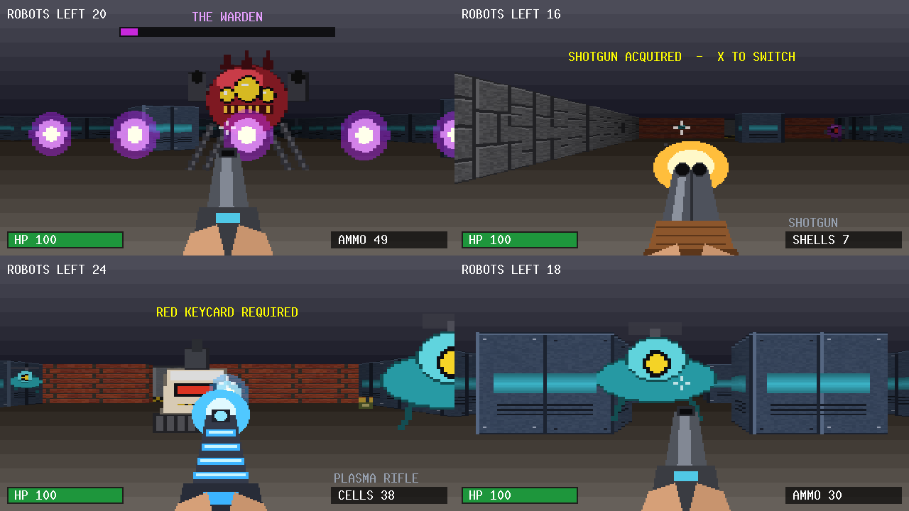

# Sentry Sweep

A Wolfenstein-style first-person shooter for the [Vircon32](https://www.vircon32.com) fantasy console. Fight through four levels of hostile robots with a blaster, shotgun and plasma rifle. Find keycards and secret areas, and destroy the Warden at the heart of the Core.

## Play

1. Install the Vircon32 emulator from [vircon32.com](https://www.vircon32.com).
2. Download `SentrySweep.v32` from this repository's Releases page, or from the root of the repository.
3. Load it in the emulator as a cartridge.

### Controls

| Gamepad | Action |
|---|---|
| D-pad Up / Down | Move forward / back |
| D-pad Left / Right | Turn |
| L / R | Strafe |
| A (hold) | Fire |
| X | Switch weapon |
| B | Use: flip the exit switch, open a suspicious wall |
| Y | Toggle minimap |
| Start | Start / continue |

## What's in it

- **Four levels:** Outer Depot, Inner Depot, Processing Plant and The Core. They have sliding doors, red and blue keycard doors, exit switches and hidden walls.
- **Five robot types:**
  - Sentries
  - Fast scout drones
  - Heavy robots with dodgeable plasma
  - Long-range turrets
  - The Warden, a boss with an enraged second phase
- **Three weapons:** the blaster, a seven-pellet shotgun and a rapid-fire plasma rifle. Weapons and ammo carry between levels.
- **Soundtrack and effects:** four looping music tracks and 19 sound effects, all synthesized by the scripts in `source/tools`.
- **A level editor** that runs in your browser.

## Make your own levels

Open `source/tools/level_editor.html` in a browser. Paint walls, doors, robots and pickups with the game's own textures. The editor checks that the level can be completed and lets you walk it in a first-person preview. When the level is ready, copy its text into `source/levels/levelN.txt` and rebuild. Levels play in file-number order, and the last one must contain the Warden. The full map format is described in [source/README.md](source/README.md).

## Build from source

You need the Vircon32 dev tools on your PATH, plus Python 3. Then run `Make.bat` (Windows) or `./Make.sh` (Linux/Mac) from the `source` folder. The ROM is written to `source/bin/VirconFPS.v32`. [source/README.md](source/README.md) covers the details: how the renderer works, the map format, and how to regenerate the art, sound and music.

## Credits

Vircon32 console and development tools: [vircon32.com](https://www.vircon32.com). All textures, sprites, sound effects and music in this game are generated by the Python scripts in `source/tools`.
